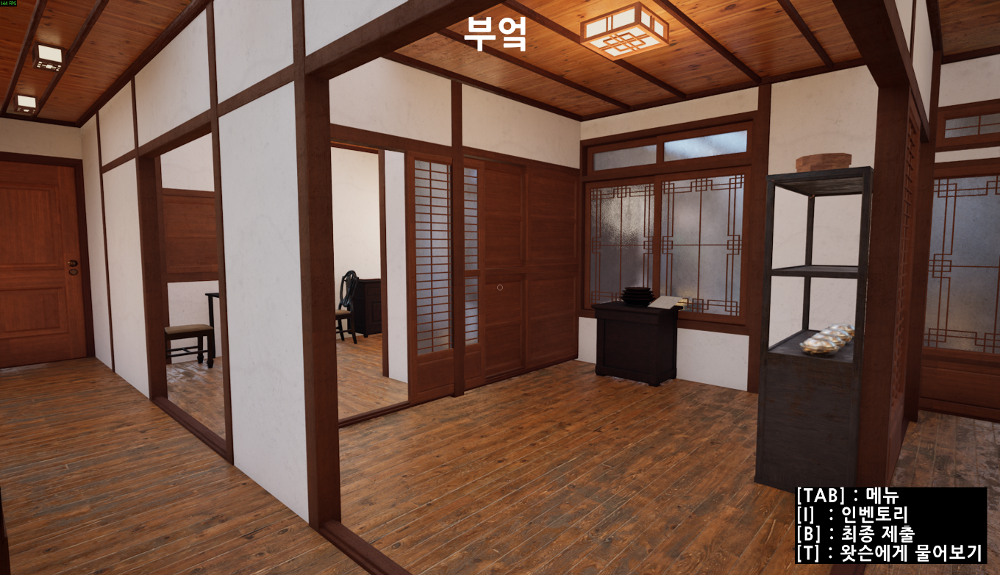
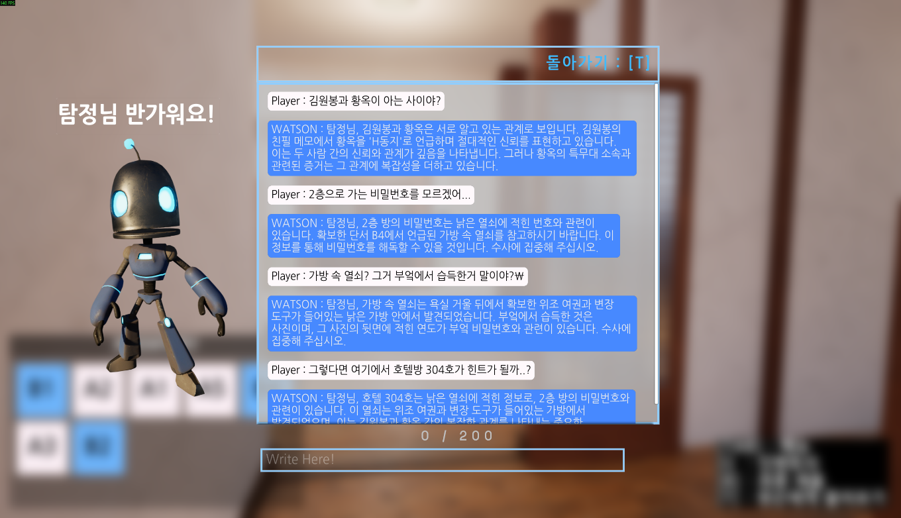
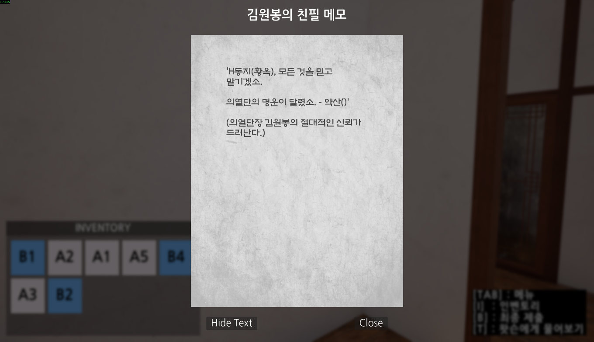
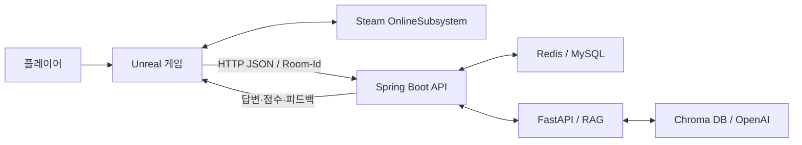

# 도와줘! 왓슨!

**Unreal Engine 5 기반 협동 역사 추리 게임**

황옥 사건을 배경으로 공간을 탐색하고, 증거를 수집하고, AI 조수와 대화하며 자신의 결론을 제출하는 3인 팀 캡스톤 프로젝트입니다. 이 저장소는 게임의 **Unreal C++ 세션 관리 및 백엔드 연동 코드**를 공개합니다.

[Windows 배포본](https://drive.google.com/drive/folders/1iyVBmlqnq_v9_JxdqsMZOD4JRYPQMbg_?usp=drive_link) · [구현 구조](docs/architecture.md) · [실행 안내](docs/running.md) · [검증 범위](docs/verification.md)

## 프로젝트 개요

| 항목 | 내용 |
| --- | --- |
| 프로젝트 | 도와줘! 왓슨! / HelpWatson |
| 형태 | 3인 팀 캡스톤 프로젝트, Windows 게임 |
| 보고서 | 2025학년도 2학기 최종보고서, 2025.12.10 작성 |
| 플레이 구성 | 보고서 기준 1~4인, 증거물 10종, 잠금 공간 해금과 최종 추리 제출 |
| 이 저장소의 범위 | OnlineSessionManager, GameState, 데이터 구조 및 모듈 설정, 프로젝트 설정(`.uproject`·`Config`) |
| 주요 기술 | C++, Unreal Engine 5, Steam OnlineSubsystem, HTTP, JSON, Delegate, RPC, Replication |

## 플레이 흐름

1. 방을 만들거나 검색한 방에 참가합니다.
2. 맵에서 증거물을 수집하고 인벤토리에서 상세 내용을 확인합니다.
3. 증거를 바탕으로 비밀번호를 추리해 잠긴 공간을 엽니다.
4. AI 조수에게 질문하고 같은 방의 플레이어들과 대화 내용을 공유합니다.
5. 사건에 대한 결론과 근거를 제출하고 점수·등급·피드백을 확인합니다.

플레이 화면과 기능 설명은 최종보고서의 구현 결과를 기준으로 합니다. 원본 Blueprint·맵·UI 에셋은 현재 공개 소스에 포함되어 있지 않습니다.

| AI 조수와 대화 | 증거물 상세 조회 |
| --- | --- |
|  |  |

## C++ 구현에서 확인할 수 있는 내용

### 세션 생성부터 참가와 종료까지

[`UOnlineSessionManager`](Source/Capstone/OnlineSessionManager.cpp)는 `UGameInstanceSubsystem`을 기반으로 OnlineSubsystem의 세션·로그인 인터페이스를 관리합니다.

- 기존 세션이 있으면 종료 완료 Delegate에서 생성 또는 참가를 이어갑니다.
- 생성된 세션 ID를 `Room-Id`로 백엔드에 전달하고, 생성 완료 후 로비로 이동합니다.
- 검색 결과의 유효성과 선택 인덱스를 확인한 후 참가 요청을 보냅니다.
- 참가 완료 시 접속 문자열을 해석해 `ClientTravel`을 수행합니다.
- 호스트의 세션 종료와 일반 참가자의 이탈을 구분합니다.

공개 코드의 로비 이동 경로에는 `?listen`이 사용됩니다. 이 버전의 게임 호스팅은 **Listen Server 흐름**으로 설명합니다.

### 게임 상태와 외부 API 연결

[`AMyGameStateBase`](Source/Capstone/AMyGameStateBase.cpp)는 증거·문 상태·질문·최종 답안을 JSON으로 직렬화해 Spring Boot API에 전달합니다.

- 요청의 `Room-Id` 헤더로 방 컨텍스트를 구분합니다.
- `OnProcessRequestComplete` 콜백에서 AI 답변과 채점 응답을 처리합니다.
- `result.answer`, `result.score`, `result.grade`, `result.feedback`를 게임 상태로 연결합니다.
- AI 응답에는 Multicast RPC와 Blueprint 이벤트를 사용하며, AI 답변과 최종 점수·등급·피드백은 복제 프로퍼티로 등록되어 있습니다.

현재 공개 소스는 서버 비용 방지를 위해 **Spring Boot로 보내는 HTTP 요청부를 주석 처리**했습니다. 로그인, 방 생성·삭제, 증거·문 상태 전송, AI 질문, 최종 제출 요청이 모두 해당하며, 각 함수의 `[Spring 통신 비활성화]` 표시 아래 블록 주석을 제거하면 복구됩니다. 비활성화 상태에서는 AI 답변과 채점 결과 이벤트가 발생하지 않습니다.

### 팀 시스템과의 연결

Spring Boot·Redis·MySQL·FastAPI·RAG는 최종보고서에 기재된 **팀 시스템 구성**입니다. 이 저장소에 공개된 C++ 코드와 구분해 소개합니다.

## 결과와 검증

최종보고서에는 방 생성·참가, 증거 수집, AI 대화, 방 해금, 최종 제출·채점, 멀티플레이 동기화, 옵션 변경에 대한 **통합시험 9개 항목의 정상 동작 결과**가 기록되어 있습니다.

보고서의 평균 60 FPS, AI 응답 3초, 가동률 99% 등은 요구사항 수치입니다. 측정 환경과 원시 결과가 함께 제공되지 않아 벤치마크 성과로 제시하지 않습니다. 현재 저장소만으로 완전한 게임을 재빌드하거나 해당 시험을 재실행할 수는 없습니다. 자세한 범위는 [검증 문서](docs/verification.md)에 정리했습니다.

## 실행과 소스 확인

- **플레이 배포본:** 공유 폴더의 `HelpWatson.zip`. 압축 내부 실행 경로는 `HelpWatson/Windows/Capstone.exe`입니다.
- **소스 검토:** [`Source/Capstone/`](Source/Capstone)에서 세션 처리와 API 연동 흐름을 확인할 수 있습니다.
- **재빌드:** 이 저장소에는 `.uproject`와 `Config`는 포함되어 있지만 맵·Blueprint·UI 에셋이 들어 있는 `Content`가 없어 원본 Unreal 프로젝트가 추가로 필요합니다.
- **서비스 의존성:** 온라인 방 검색은 Steam 로그인이 필요하며, AI 대화·채점은 별도 백엔드와 AI 서비스에 의존합니다. 공개 소스는 Spring 요청이 비활성화되어 있으며, 배포본의 현재 외부 서비스 연결 상태는 확인되지 않았습니다.

## 자료 출처

- 팀 최종보고서 「도와줘! 왓슨!」: 개요, 플레이 화면, 통합시험 기록, 전체 시스템 설명
- 이 저장소의 C++ 소스: 세션 수명주기, HTTP/JSON 요청·응답, 복제 필드
- 공유 `HelpWatson.zip`의 파일 목록: Windows 배포 구성과 실행 파일 위치

보고서에 기재된 관련 저장소: [Backend](https://github.com/soohyun1904/watson), [AI](https://github.com/hjzang/watson_ai). 해당 저장소의 현재 접근 가능 여부와 코드는 별도로 검증하지 않았습니다.
