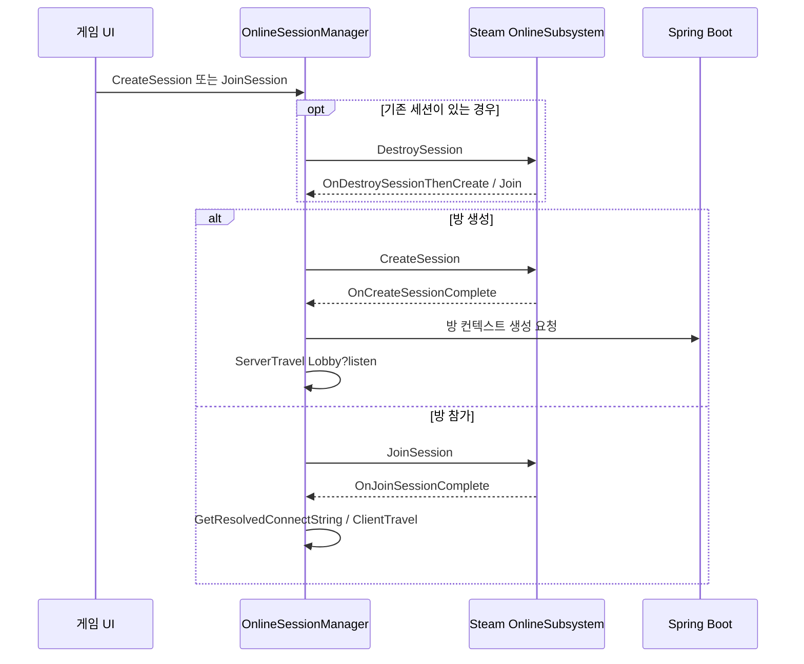

# Unreal C++ 구현 구조

게임 세션의 수명주기는 `UOnlineSessionManager`, 게임 진행 데이터와 API 응답은 `AMyGameStateBase`에서 다룹니다. 아래 설명은 공개 C++ 코드 기준이며, Blueprint 내부 처리는 포함하지 않습니다.

## 세션 수명주기

`CreateRoomOnSpring`의 HTTP 완료를 기다린 뒤 이동하는 구조는 아닙니다. 방 컨텍스트 생성 요청 후 로비 이동을 시작하므로, 백엔드 초기화 완료와 게임 시작 사이의 순서는 후속 검증 지점입니다.

## API 데이터 흐름

| 코드 진입점 | 전달 데이터 | 응답 또는 상태 반영 |
| --- | --- | --- |
| `CreateRoomOnSpring` | `room_id`, `host_user_id`, `max_players` | 방 컨텍스트 생성 요청 |
| `InitRoomContext` | `Room-Id` 헤더 | 방 초기화 요청 |
| `AddNoteItem` | `note_name`, `he_spy`, `item_id` | 로컬 배열 추가 후 증거 정보 전송 |
| `AddDoorState` | `door_id`, `locked` | 로컬 배열 추가 후 문 상태 전송 |
| `SendAIQuestion` | `question` | `result.answer`를 파싱해 Multicast 및 Blueprint 이벤트로 전달 |
| `SendFinalSubmitToSpring` | `sheet`, `shared_inventory`, `door_states` | `result`의 점수·등급·피드백을 저장하고 Delegate 호출 |

요청은 `FHttpModule`로 생성하며 `Room-Id` 헤더를 사용합니다. AI 질문과 최종 제출은 비동기 완료 콜백에서 JSON 응답을 파싱합니다. 최종 결과의 `grade`, `feedback`은 `TryGetStringField`로 읽습니다.

## 복제와 UI 알림

`GetLifetimeReplicatedProps`에 등록된 필드는 `AIAnswer`, `FinalScore`, `FinalGrade`, `FinalFeedback`입니다. AI 답변은 `Multicast_AIAnswerUpdated`에서 `OnAIAnswerUpdated_BP` 이벤트로 연결됩니다. 최종 제출 응답은 `OnFinalSubmitResult` Delegate를 호출합니다.

현재 헤더의 `SharedInventory`와 `DoorStates`에는 `Replicated` 지정이 없습니다. 최종보고서에는 증거·문 상태 공유가 동작한다고 기록되어 있지만, 공개 C++만으로 그 전체 구현을 확인할 수는 없습니다. 원본 Blueprint와 호출 주체까지 확인해야 완전한 동기화 경로를 설명할 수 있습니다.

## 설계에서 다룬 문제

| 문제 | 공개 코드의 처리 |
| --- | --- |
| 기존 방이 있는 상태에서 새 방 생성·참가 | 기존 세션 제거 완료 후 다음 작업을 Delegate에서 시작 |
| 잘못된 검색 결과 선택 | 결과 배열 인덱스 확인 후 참가 처리 |
| 비동기 AI 응답과 화면 갱신 연결 | HTTP 완료 콜백 → JSON 파싱 → Multicast → Blueprint 이벤트 |
| 방마다 다른 진행 데이터 유지 | 세션 ID 기반 `Room-Id`를 요청 헤더에 전달 |
| 선택 필드가 없는 채점 응답 | 등급·피드백을 `TryGetStringField`로 읽고 기본값 적용 |

## 소스 위치

- [`OnlineSessionManager.cpp`](../Capstone/OnlineSessionManager.cpp)
- [`OnlineSessionManager.h`](../Capstone/OnlineSessionManager.h)
- [`AMyGameStateBase.cpp`](../Capstone/AMyGameStateBase.cpp)
- [`AMyGameStateBase.h`](../Capstone/AMyGameStateBase.h)
- [`Capstone.Build.cs`](../Capstone/Capstone.Build.cs)
